# Codes & Ciphers Studio

**by Larry Dalton**

89 working codes, ciphers and ways of hiding a message, following the chapters of Sunil Tanna's
*Codes, Ciphers, Steganography & Secret Messages*, plus chapters of cipher wheels and devices, spy ciphers and cipher
machines, and the stream ciphers in your phone, Wi-Fi and travel card. Everything runs on your own Windows computer at
`http://localhost:8771/`; nothing you type leaves the machine.

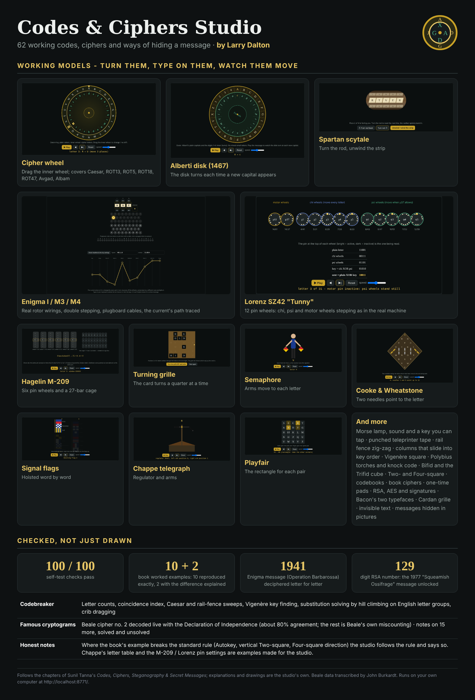

## Working models

| | |
|---|---|
| 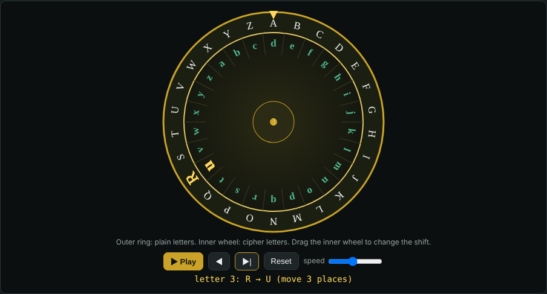 | 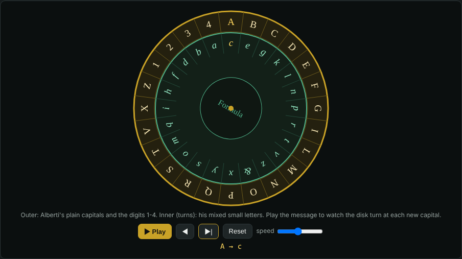 |
| 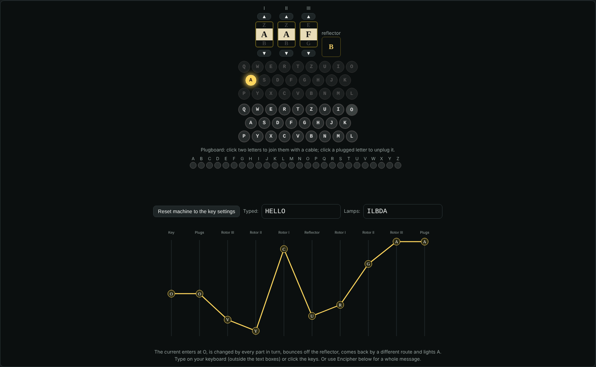 | 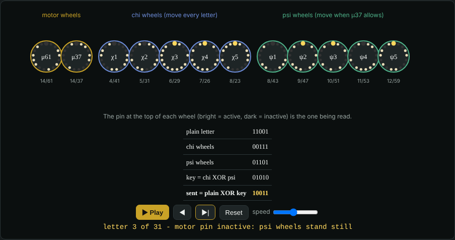 |

- **Cipher wheel** you can drag (Caesar, ROT13, ROT5, ROT18, ROT47, Avgad, Albam) and **Alberti's disk** that turns at each capital
- **Enigma** I / M3 / M4 with real rotor wirings, double stepping, plugboard cables and the current's path drawn
- **Lorenz SZ42** with its 12 pin wheels, and the **Hagelin M-209** pin wheels and lug cage
- **Scytale** rod that turns and a strip that unwinds; **turning grille** that rotates; trellis, crossword and Cardan grilles
- **Semaphore**, **Chappe telegraph**, **Cooke & Wheatstone** needles, **signal flags**, **Morse** lamp, sound and tap key, punched **teleprinter tape**
- Rail fence zig-zag, columns that slide into key order, route paths, Vigenère square, Polybius torches, knock code, Bifid, Trifid cube, Playfair, Two-square and Four-square

## New in 1.1: cipher wheels and devices

| | |
|---|---|
| 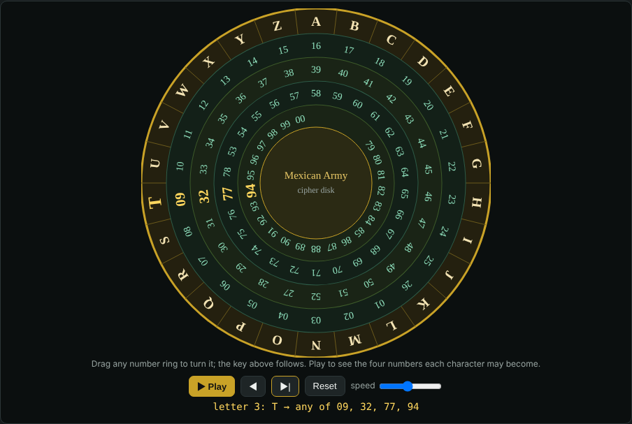 | 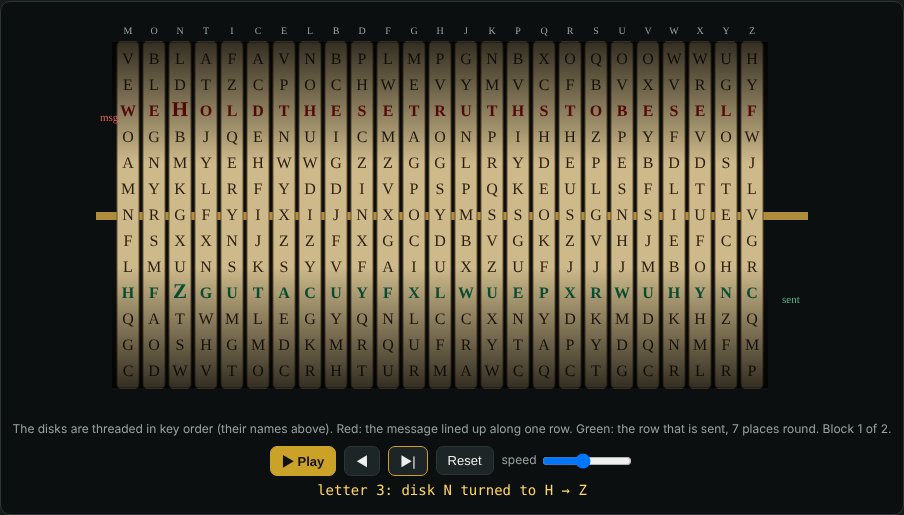 |
| 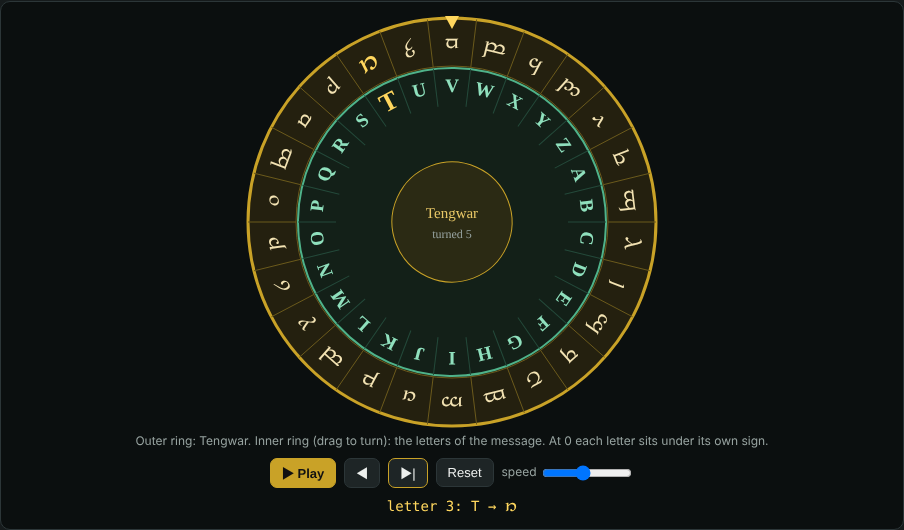 | 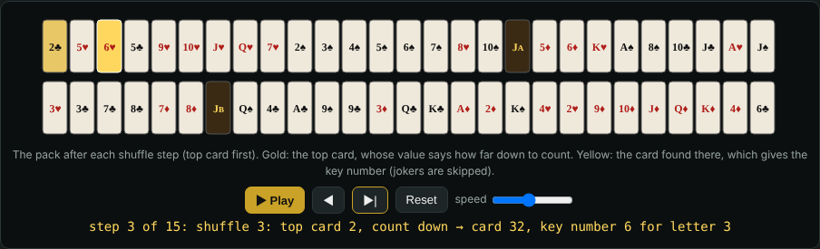 |

- **Mexican Army cipher wheel** and the **Janelle cipher**: number rings you can drag; every letter has four numbers to choose from
- **Jefferson wheel cypher / M-94**: 25 disks in key order; deciphering finds the readable row by itself
- **Enigma slide cipher**, **Confederate Army cipher disk** (Manchester Bluff, Complete Victory, Come Retribution), **Chaocipher** (two stirred wheels) and **Solitaire** (a pack of cards you can watch shuffle)
- **Alphabet wheels**: Braille, runes, Elvish (Tolkien's Tengwar), Pharaoh's hieroglyphs, Ogham and Theban
- **Heath's deciphering dice**: Royal V. Heath's 1927 lightning-addition trick, with dice you can roll
- **ADFGVX / ADFGX** (German Army, 1918) and the **Hill cipher** (1929) join chapters 5 and 6

## New in 1.2: spy ciphers, cipher machines and stream ciphers

| | |
|---|---|
| 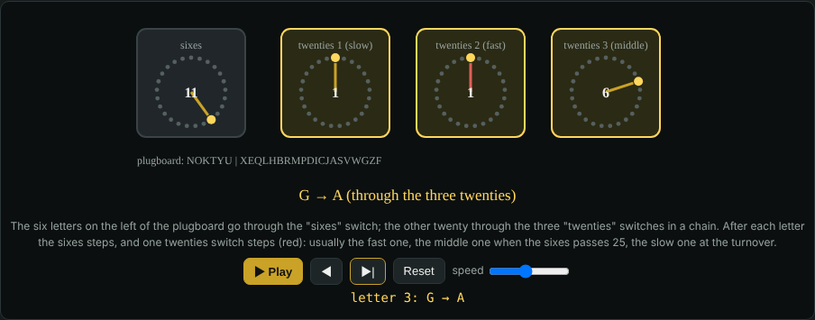 | 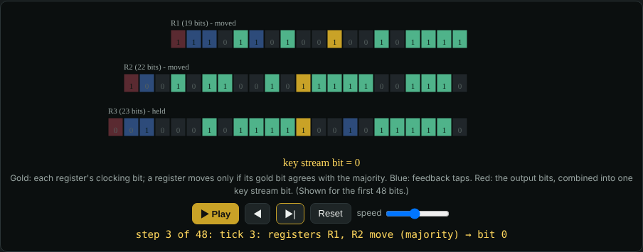 |

- **PURPLE**, Japan's stepping-switch machine, with the wiring from *PURPLE Revealed*; the Famous page deciphers part 1 of the
  14-part message of 7 December 1941, live
- **SIGABA**, the American machine that was never broken: watch the control and index rotors pick which cipher rotors move
- **VIC cipher**, the KGB pencil cipher of the hollow-nickel case, with every key line A to S shown, and the **straddling checkerboard**
- **Stream ciphers in your pocket**: **A5/1** (GSM phones), **RC4** (Wi-Fi, early secure websites), **Crypto-1** (MIFARE Classic
  travel cards), **Salsa20** (ancestor of ChaCha20) and **Trivium**, each with its registers or table stepping bit by bit
- **Affine cipher** and **Diffie-Hellman key exchange** (with the paint-mixing picture)
- **Kryptos panel K1** deciphered live on the Famous page

## Chapters covered

| Chapter | In the studio |
|---|---|
| 1 Communication codes | Signal flags, semaphore, Polybius square, tap code, Chappe, Cooke & Wheatstone, Morse, Baudot (1888 patent table), ITA2, ASCII/hex/Base64 |
| 2 Caesar ciphers | Caesar, ROT13, ROT5, ROT18, ROT47, Avgad, Albam, affine |
| 3 Substitution | Atbash, keyword, pigpen, symbol sets, homophonic, nulls |
| 4 Transposition | Scytale, rail fence, route, columnar, double columnar, Myszkowski, disrupted, trellis, Fleissner, crossword |
| 5 Fractionation | Bifid, Trifid, ADFGVX / ADFGX |
| 6 Polygraphic | Playfair, Two-square, Four-square, Hill |
| 7 Polyalphabetic | Alberti, Trithemius, Vigenère, Beaufort, Variant Beaufort, Autokey, Hagelin M-209 |
| 8 Enigma | Enigma I / M3 / M4 |
| 9 Perfect ciphers | Vernam, one-time pad, Lorenz SZ40/42 |
| 10 Codewords | One-time code, nomenclator |
| 11 Book ciphers | Book word, book letter (Beale style), running key |
| 12 Computer cryptography | AES-256 (Web Crypto), RSA, SHA hashes and ECDSA signatures, Diffie-Hellman key exchange |
| 13 Steganography | Null ciphers, Bacon's cipher, Cardan grille, invisible text, messages hidden in pictures |
| 14 Cipher wheels and devices | Mexican Army wheel, Janelle cipher, Enigma slide, Heath's dice, Braille, runes, Tengwar, hieroglyph, Ogham and Theban wheels, Confederate disk, Jefferson / M-94, Chaocipher, Solitaire |
| 15 Spy ciphers and cipher machines (1.2) | Straddling checkerboard, VIC, SIGABA, PURPLE |
| 16 Stream ciphers in your pocket (1.2) | A5/1, RC4, Crypto-1, Salsa20, Trivium |

Plus a **Codebreaker** (letter counts, coincidence index, Caesar / Vigenère / substitution solvers, crib dragging)
and **Famous cryptograms**: Beale cipher no. 2 decoded live with the Declaration of Independence, and the 1977
RSA-129 "The Magic Words are Squeamish Ossifrage" message unlocked with the 1994 factors.

## Checked, not just drawn

The Self-test page runs 143 checks: the book's worked examples (10 reproduced exactly; 2 differ from the book
for documented reasons), standard published test messages, the 1941 Operation Barbarossa Enigma message,
Enigma's double step, round trips through every cipher, AES, RSA, signatures and picture hiding, and (new in 1.1)
the published test messages for ADFGVX, Hill, Chaocipher and Solitaire, dCode's Mexican Army example and Heath's rule
for all 7,776 rolls of the dice; and (1.2) part 1 of the 1941 PURPLE message, the A5/1 reference frame, eSTREAM vectors for
Salsa20 and Trivium, Wikipedia's RC4, checkerboard, affine and Diffie-Hellman examples, the VIC key lines A to S, and Crypto-1
against the Proxmark3 crapto1 library.
`node test/vectors.js` runs the same engine checks from the command line.

Exhaustive tests: `node test/exhaustive.js` enciphers, groups (off, 3, 4, 5) and deciphers every code and cipher with
10 messages and every key option (26,008 round trips, all passing; in 6,068 of them the studio rightly refuses the setting:
mostly a test word typed where hexadecimal digits are needed, or a message too long for its cover text, or a Hill key that cannot be undone); `node test/ui-exhaustive.js` repeats that in a real
browser through the buttons, plays every step of every working model and checks the page fits the window (834 checks);
`node test/play-matches.js` and `node test/tabula.js` check that what each model highlights agrees with the result.

Honest notes: where the book's own example breaks the standard rule (Autokey, vertical Two-square,
Four-square direction) the studio follows the rule and says so. Chappe's letter-to-position table and the
M-209 and Lorenz pin settings are examples made for the studio. The Janelle cipher, Enigma slide and Heath's dice are
wooden products by Creative Crafthouse: the slide's method is the studio's reading of it (the maker keeps the instructions in
the box) and the dice faces are the studio's own, built on Heath's rule. The script wheels give each English letter one sign,
as cipher wheels do; real runes, Tengwar and hieroglyphs were written by sound. Jefferson's own disk alphabets are lost, so the
cylinder uses the US Army M-94's 25 disks. SIGABA's real rotor wirings were never published, so its wirings are examples; no
complete published VIC message with all its keys was available, so the VIC key lines are checked against the published example
and whole messages by round trips.

## Install

Download `CodesCiphersStudio-Setup.exe` from Releases and run it, or unzip `CodesCiphersStudio-Package.zip`
and double-click `Install.cmd`. Installs for your Windows account only (no administrator rights), starts at
sign-in and is verified over HTTP; a failed install restores the previous version.

## Credits

Beale cipher 2, its solution and the Declaration of Independence: transcription by John Burkardt.
English letter-group scores counted from Shakespeare (public domain) and the Declaration.
Fonts: Noto Sans Runic and Noto Sans Ogham (The Noto Project Authors), Alcarin Tengwar (Toshi Omagari) and NewGardiner
(Mark-Jan Nederhof), all SIL Open Font License, subset and renamed; Theban from public-domain outlines on Wikimedia Commons.
See [NOTICE.md](NOTICE.md).
